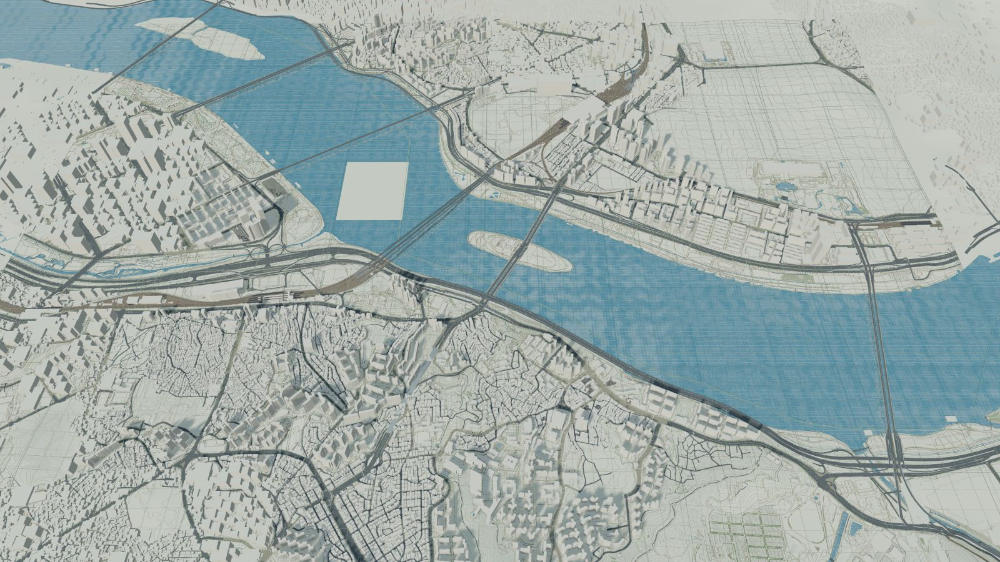
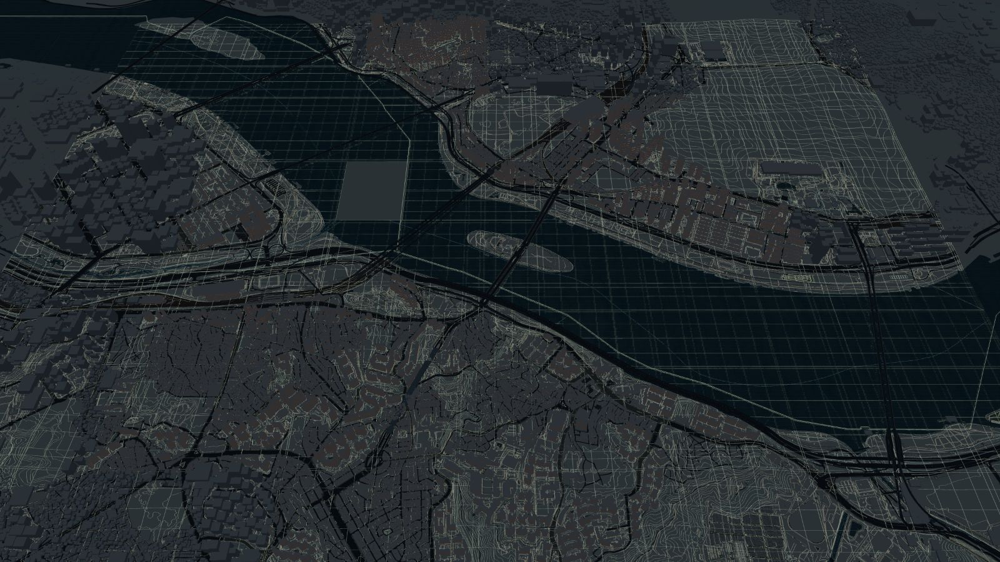
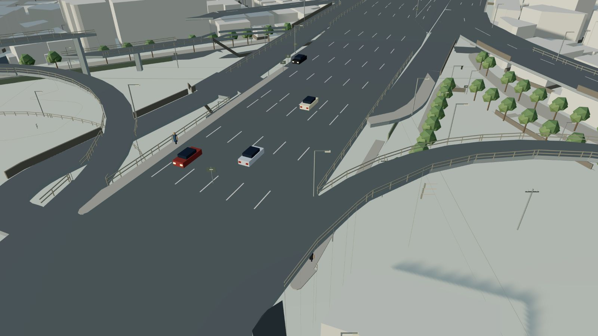
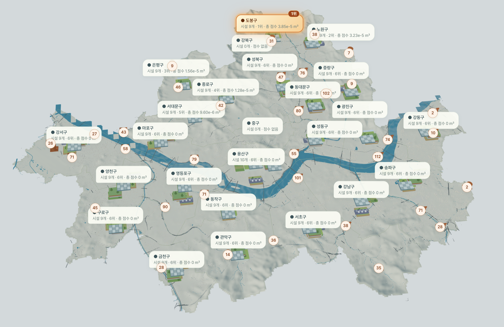
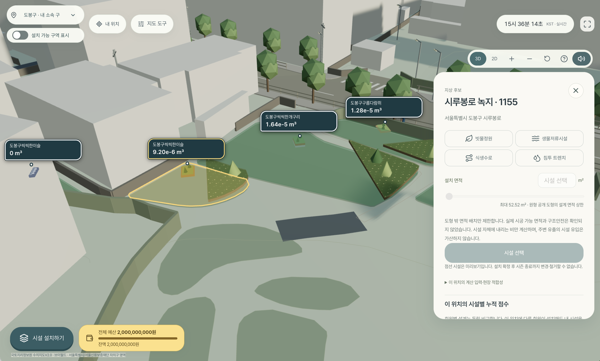
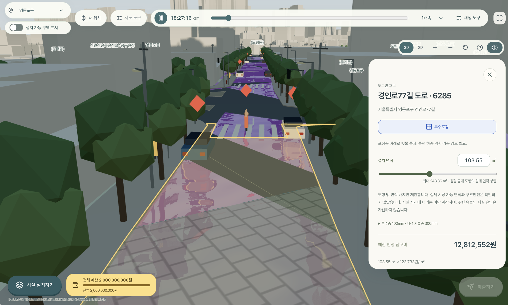

# WATER LEAGUE

**서울에서 시작하는 빗물 전략 게임**

서울 지도에 빗물관리 시설을 배치하고, 실제 관측 강우로 설치 전후의 변화를 비교합니다. 수달 여울이·물총새 가람이와 함께 우리 구의 주간 대항전에 참여하거나 과거 호우를 재생해 나만의 설계를 실험할 수 있습니다.

서울 25개 구 · 2D·3D 지도 · 두 가지 게임 모드 · 7종의 시설

[사이트 바로가기](https://waterleague.cloud/) · [주간 서울 대항전](https://waterleague.cloud/weekly) · [재해 모드 체험](https://waterleague.cloud/disaster) · [대회 둘러보기](https://waterleague.cloud/competitions)


## 게임 속 서울

한강과 교량, 건물과 도로를 서울 25개 구의 공개 수치지형도로 구현했습니다. 2D·3D 지도를 오가며 설치할 지붕·도로·식재 공간을 살펴보세요. 같은 서울을 낮과 밤의 모습으로 둘러볼 수 있습니다.



<details>
<summary>같은 위치의 밤 지도 보기</summary>



</details>

사람과 차가 오가는 거리도 함께 표현합니다. 공개 생활인구·주요 장소의 인구·평균 도로 속도를 참고해 게임 속 사람과 차량의 표시량과 움직임을 조절하며, 개별 사람·차량의 실제 위치를 나타내지는 않습니다.



## 주간 서울 대항전

우리 구에 시설을 설치하고 실제 관측 강우로 계산되는 효과를 쌓습니다. 개인과 구의 누적 점수를 실시간 랭킹에서 함께 비교할 수 있습니다.

- 로그인 후 자기 소속 구에 시설 설치
- 설치 시각 이후 관측 강우에 대한 효과 누적
- 개인·구별 랭킹 갱신, 매주 월요일 00:00 KST 새 시즌 시작



### 다른 플레이어의 시설도 같은 지도에서

누가 어디에 어떤 시설을 설치했는지, 그 시설의 누적 점수가 얼마인지 지도에서 확인할 수 있습니다. 같은 위치에서도 회원별 설계를 독립적으로 비교하므로 다른 사람의 설치가 내 설치 위치를 독점하지 않습니다.



[우리 구에서 시작하기](https://waterleague.cloud/weekly) · [랭킹 보기](https://waterleague.cloud/rankings)

## 재해 모드

2010·2011·2022년 실제 호우의 관측 강우와 침수 기록을 살펴보고, 같은 비에 내 시설 배치가 어떤 차이를 만드는지 시뮬레이션으로 실험합니다.

- 로그인 없이 서울 25개 구에서 시설 배치 체험
- 일시정지·배속·시간 탐색으로 설치 이후 효과 확인
- 로그인 후 사건 전체 기간에 적용할 설계 제출, 같은 계산 조건끼리 개인 최고 기록 비교



[재해 모드 체험하기](https://waterleague.cloud/disaster)

게임 이미지는 촬영 당시의 화면입니다. 현재 순위와 점수는 사이트에서 확인할 수 있습니다.

## 빗물을 다루는 7가지 시설

예산 안에서 시설의 종류·위치·면적을 선택합니다. 홈에서는 시설별 3D 모형을 돌려 보며 설치 위치와 역할을 살펴볼 수 있습니다.

| 시설 | 설치 위치 | 역할 |
| --- | --- | --- |
| 빗물정원 | 허용된 지상 식재 공간 | 낮게 만든 식재 공간에 빗물을 담고 토양으로 침투 |
| 투수포장 | 도로·보도·주차장 후보 | 포장 틈을 통해 아래층으로 빗물 통과 |
| 녹화지붕 | 건물 지붕 | 흙·식물층에 빗물을 머금고 유출 지연 |
| 생물저류시설 | 허용된 지상 식재 공간 | 식재토·쇄석층의 저류와 침투 |
| 식생수로 | 허용된 지상 수로 공간 | 식생이 있는 얕은 수로의 흐름과 침투 |
| 침투 트렌치 | 허용된 지상 도랑 공간 | 쇄석 사이에 빗물을 담고 바닥으로 침투 |
| 빗물이용조 | 건물 지붕과 옆 탱크 | 지붕 집수부와 크기를 선택한 탱크를 함께 배치해 저류 |

## 기관·기업·정부 대회

승인된 조직은 실시간 또는 재해 모드로 대회를 개최할 수 있습니다. 개최 지역·허용 시설·기간·1인당 기본 예산 또는 직접 설정한 금액·시상 조건을 정하고, 참가자는 대회별 예산으로 설계합니다. 실시간 대회에서는 소속 구와 관계없이 대회에 포함된 모든 구에 설치할 수 있습니다.

주최 조직과 관리자는 대회 결과의 시설 구성·구별 분포·활동·점수 분포 시각화와 집계 통계에 대한 AI 요약을 확인할 수 있습니다.

[대회 둘러보기](https://waterleague.cloud/competitions)

## 점수와 제공 범위

**점수(m³) = 설치 전 평가체적 − 설치 후 평가체적**

평가체적은 `표면 유출 + 시설 배수 + 종료 저류 − 시작 저류`입니다. 물을 잠시 저장한 것을 영구 저감으로 계산하지 않으며, 녹화지붕을 포함한 시설 점수가 실제 지상·지하 침수 수심·범위·피해 저감을 뜻하지는 않습니다. 관측 결측·계산 대기는 실제 0점과 구분합니다.

현재 결과는 명시한 가정 아래의 탐색 계산입니다. 서울 전역 지도 제공이 서울 전역의 검증된 실시간 침수 예측을 뜻하지 않습니다.

**제공 범위와 미지원 항목은 [완료 범위·제외 기준](docs/01-product.md)을 따른다.** 서울 25개 구 수치지형도로 지도·설치 후보·주간/재해 계산의 공간 참조를 통일했다. 일반 설치 7종의 예산·관측 계산·저장·제출·체적 차이 순위를 제공한다. 빗물이용조는 건물과 크기를 선택하면 지붕 집수부·건물 옆 탱크가 함께 설치되며 문헌 용량·참고비와 명시한 배수 가정으로 계산한다. 실제 제품/시공 검증·소형 통 제품·실제 연결 유역·전체 LCC·현장 관리 회복 예측은 제외한다.

[자료와 계산 근거](https://waterleague.cloud/#home-data) · [점수 계산 자세히 보기](https://waterleague.cloud/#home-score)

## 문서 안내

| 필요한 내용 | 기준 문서 |
| --- | --- |
| 현재 게임 규칙·설치·예산·권한 | [제품](docs/01-product.md) · [화면·조작](docs/08-experience.md) |
| 완료 범위·미지원·제외 조건 | [제공 범위](docs/01-product.md) |
| 수치 의미·가정·검증 한계 | [연구 적합성](docs/02-scientific-validity.md) · [EPA 참조 검증](docs/20-epa-reference-validation.md) |
| 공개자료·추가 확보 여부 | [출처](docs/03-data-provenance.md) · [자료 현황](docs/13-data-access.md) · [공간자료 검사](docs/19-spatial-source-audit.md) |
| 현재 서울 1:1,000 수치자료의 레이어·속성·코드 | [데이터 설명서](docs/21-seoul-topography-data-dictionary.md) |
| 강우·수위 자료와 비교 | [강우 카탈로그](docs/11-rainfall-catalog.md) · [서울 관측](docs/14-seoul-observations.md) · [관망·수위](docs/15-sewer-observations.md) |
| 시스템·저장·API·보안 | [아키텍처](docs/04-architecture.md) · [데이터 모델](docs/05-data-model.md) · [API](docs/06-api.md) · [보안](docs/07-security.md) |
| 현재 대회·관리자 결과 | [제품](docs/01-product.md#대회--2026-10-21) · [API](docs/06-api.md#대회와-관리자-결과--2026-10-21) |
| 보존된 연구 서버·권한 계약 | [과거 연구 리그](docs/17-league-participation.md) · [분석·후보 탐색](docs/18-institution-analysis.md) · [활용 동의](docs/16-utilization-consent.md) |
| 실행·배포·검증 증거 | [운영](docs/10-operations.md) · [검증 이력](docs/12-validation-log.md) · [기여 규칙](CONTRIBUTING.md) |

현재 계약은 해당 기준 문서에만 적고 날짜별 시험 결과는 검증 이력에 남긴다. 과거 이력의 화면·정책을 현재 요구사항으로 읽지 않는다. 삭제·통합한 문서의 이전 내용은 Git 이력에서 확인할 수 있다.

## 구성

React 19·TypeScript·Vite·R3F/Three.js 프론트, Java 25·Spring Boot API, PostgreSQL 작업 큐/세션, Python의 고정 EPA SWMM·ANUGA 계산으로 구성한다. 세부 버전은 lockfile·빌드 설정이 기준이다. 승인된 조직 회원은 대회를 개최하고, 관리자는 주간 시즌·재해·대회 결과를 조회한다. 기관 리그·연구실의 미사용 프론트 코드는 제거했으며 이전 기록·동의·재현에 필요한 서버 경로와 원자료는 보존한다.

[프론트 실행](frontend/README.md) · [API 실행](backend/README.md) · [계산 워커](simulation/README.md) · [데이터 관리](data/README.md)

현재 페이지 주소는 소개 홈 `/`, `/weekly`, `/disaster`, `/rankings`, `/competitions`이며 관리자는 `/admin/members`, `/admin/results`를 사용한다. 홈에서는 수달 여울이·물총새 가람이, 실제 게임 화면과 시설별 3D 모형으로 게임을 소개한다. 게임 시작 시 두 모드를 선택하고 홈에서 점수 공식·기간·집계 예시를 확인한다. 기존 데이터 내용은 홈 맨 하단 `/#home-data`에 통합하며 데이터 메뉴·별도 페이지는 제거한다. 재해 사건과 대회 상세도 개별 주소를 갖는다. 직접 접근·새로고침·뒤로 가기 계약은 [화면 문서](docs/08-experience.md#페이지-주소)에 둔다.

## 로컬 실행

JDK 25, Node 22.13 이상, pnpm 11.25.0, Python 3.12~3.14, uv, PostgreSQL, CMake·C 컴파일러 필요. macOS SWMM 빌드는 Homebrew libomp 사용.

`.env.example`은 빈 비밀값 템플릿이다. 기존 `.env.local`을 그대로 사용하고, 첫 설정에서만 예제를 복사한다. 환경변수가 우선이며 `.env.local`, `.env` 순으로 미설정 값만 읽는다. DB 접속정보는 `DB_URL`, `DB_USER`, `DB_PASSWORD`, 워커는 `DATABASE_URL`; 외부 강우 재수집에만 `KMA_API_KEY` 필요. 공개된 파생 강우로 계산할 때는 기상청 키가 필요하지 않다. 게임 분석 AI 요약에는 서버 전용 `UPSTAGE_API_KEY`를 사용하며 운영에서는 같은 이름의 GitHub Actions Secret으로 설정한다.

지도·설치 후보·과거 사건·건물 대조는 저장된 버전의 자료를 사용한다. 주간 기상청 관측과 서울시 현재 도시데이터는 서버에서 직접 조회하며, 관측 시각·유효기간·실패 상태를 구분한다. 인증키를 사용하는 외부 자료 수집은 수집·진단 도구에서 수행하고 키를 브라우저·계산 자식 프로세스에 전달하지 않는다. 건물 대조는 번들 JSON·SHA-256을 서버 시작 시 검사한다. 자료 갱신 후에도 이전 계산의 자료 버전은 보존한다.

```sh
# 저장소 루트, 새 환경에서만 로컬 설정 파일 준비
cp -n .env.example .env.local
chmod 600 .env.local
# .env.local에 실제 DB 접속정보 설정, DB 준비 후 실행
uv sync --project simulation --locked
bash scripts/build_swmm.sh
pnpm --dir frontend install --frozen-lockfile
# 각각 별도 터미널
python3 scripts/run_local.py api
python3 scripts/run_local.py worker
python3 scripts/run_local.py frontend
```

macOS 다중 JDK 환경: `export JAVA_HOME=$(/usr/libexec/java_home -v 25)`. 개발 DB 기본 포트 55432, API 8080, [웹 5173](http://127.0.0.1:5173/weekly). Spring Flyway가 스키마 적용. 통합 시험은 격리 PostgreSQL, 실제 로컬 실행도 PostgreSQL을 사용한다. 기본 관리자·우회 계정 없음.

## 검증

```sh
simulation/.venv/bin/python scripts/verify_league_postgres.py --suite backend
pnpm --dir frontend test
pnpm --dir frontend build
PYTHONPATH=simulation simulation/.venv/bin/python -m unittest discover -s simulation/tests -v
python3 scripts/verify_snapshot.py
python3 scripts/verify_model.py
# 내려받은 재현 묶음: 현재 설치된 동일 빌더와 엔진만 실행
simulation/.venv/bin/python scripts/verify_bundle.py /path/to/bundle.zip --rerun
```
